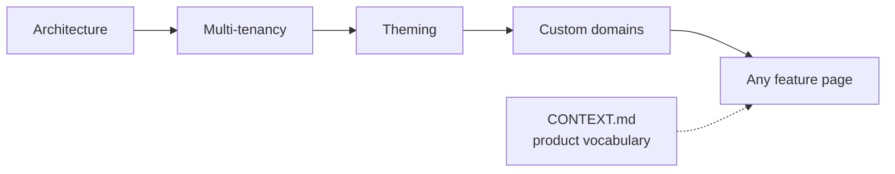

# qmenut docs

Multi-tenant restaurant menu SaaS. Owners run menu, brand, promotions, loyalty and reservations from an admin; diners see a per-branch public menu on the restaurant's own domain.

Docs describe what the code does today. **Code wins**: if a page disagrees with it, fix the page. `file:line` references drift; trust the path and symbol.

## Read first

1. [Architecture](architecture.md): Workers, request flow, data, code layers.
2. [Multi-tenancy](domains/multi-tenancy.md): tenant model and isolation. Every feature depends on it.
3. [Theming](domains/theming.md) and [Custom domains](domains/custom-domains.md): how a branch gets its look and its host.
4. [CONTEXT.md](../CONTEXT.md): the words to use (restaurant, branch, guest, stamp request…).

## Map

| Area       | Pages                                                                                                                                                                                                                                                                                                                                                                                                                                                                            |
| ---------- | -------------------------------------------------------------------------------------------------------------------------------------------------------------------------------------------------------------------------------------------------------------------------------------------------------------------------------------------------------------------------------------------------------------------------------------------------------------------------------- |
| Domains    | [Multi-tenancy](domains/multi-tenancy.md) · [Theming](domains/theming.md) · [Custom domains](domains/custom-domains.md) · [Menu](domains/menu.md) · [Promotions](domains/promotions.md) · [i18n](domains/i18n.md) · [Loyalty](domains/loyalty.md) · [Reservations](domains/reservations.md) · [Notifications](domains/notifications.md) · [Billing](domains/billing.md) · [Auth](domains/auth.md) · [QR](domains/qr.md)                                                          |
| Apps       | [Public menu Worker](apps/web-public-menu.md) · [Public menu PWA](apps/web-pwa.md) · [Admin](apps/admin.md) · UI kit: [packages/ui/CONTRIBUTING.md](../packages/ui/CONTRIBUTING.md)                                                                                                                                                                                                                                                                                              |
| UX design  | [Loyalty](design/loyalty-ux.md) · [Reservations](design/reservations-ux.md) · [Notifications](design/notifications-ux.md)                                                                                                                                                                                                                                                                                                                                                        |
| Decisions  | [ADRs](adr/): image publication (0001), retranslate (0002), WhatsApp on hold (0003), reservation access by email (0004), notifications via Queues (0006), unanswered stamp requests accepted (0007), reservations booked + email confirm (0008)                                                                                                                                                                                                                                  |
| Operations | [Deployment](operations/deployment.md) · [Database migrations](operations/database-migrations.md) · [Testing](operations/testing.md) · [Performance and caching](operations/performance-and-caching.md) · [Image uploads](operations/image-uploads.md) · [Branch maps](operations/branch-geocoding.md) · [Google reviews](operations/google-reviews.md) · [Restaurant intake](operations/onboarding-intake.md) (ES) · [Production checklist](operations/production-checklist.md) |
| Business   | [sales/](sales/) (Spanish): playbook, sales sheets, plan features, landing copy, beta readiness                                                                                                                                                                                                                                                                                                                                                                                  |

## Writing docs

- State what is true. No history, no "previously", no dated verification logs — that's git's job.
- One diagram beats three paragraphs. Use Mermaid.
- Point at config (`wrangler.jsonc`, schema) instead of copying IDs and values.
- Feature pages use: Status · Data model · Backend · Frontend · Example · Key files · Limitations.
- A decision with a real trade-off gets an ADR in `adr/`. Delete a superseded ADR and mention it in its replacement.
