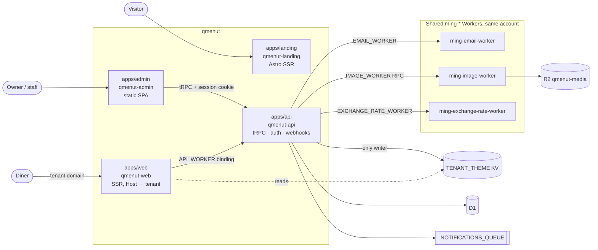
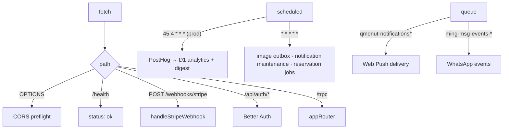
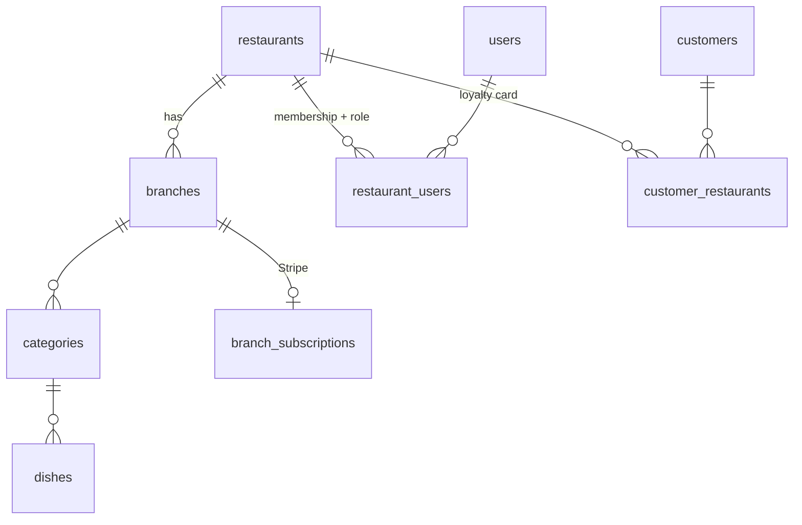
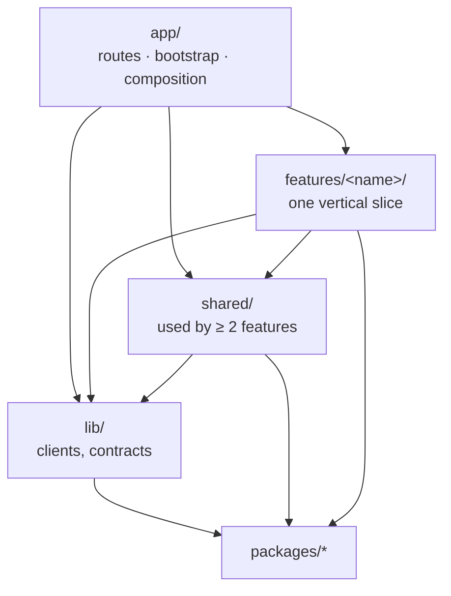

# Architecture

Bun `1.4.0` monorepo run by Turbo. Everything runs on Cloudflare Workers; there is no other server.

## System



| Worker           | Reads / writes                                                                                       |
| ---------------- | ---------------------------------------------------------------------------------------------------- |
| `qmenut-web`     | One Worker for every tenant domain. Reads `TENANT_THEME` directly, everything else via `API_WORKER`. |
| `qmenut-api`     | Only Worker that touches D1 and writes `TENANT_THEME` (`src/lib/theme/tenant-theme-store.ts`).       |
| `qmenut-admin`   | Static assets with SPA fallback. Calls `api.qmenut.app` cross-origin with cookies.                   |
| `qmenut-landing` | Standalone marketing site. Production only.                                                          |

Rules:

- **Host is the tenant.** `branches.customDomain` ↔ request `Host`. No path, slug or wildcard. See [Custom domains](domains/custom-domains.md).
- **Browsers never call the API from a tenant domain cross-origin.** They hit same-origin `/trpc`, which `qmenut-web` proxies through `API_WORKER`.
- **One KV writer.** Lint (`no-restricted-properties`) rejects `TENANT_THEME` outside the store; web types the binding read-only.
- **Same KV `preview_id` in api and web.** Locally, web persists into `apps/api/.wrangler/state`, keyed by that ID.

## API Worker

`apps/api/src/index.ts` exports three handlers, wrapped in `Sentry.withSentry`:



A fresh context and Drizzle client are built per request (`createContext`). Never keep either in module scope.

### tRPC

`apps/api/src/trpc/router.ts`:

```text
appRouter
├─ auth · health
├─ menu · loyalty · reservations          public (diners)
└─ admin.*                                tenantProcedure
   analytics · tenant · menu · branches · exchangeRates · images · promotions · theme
   billing · loyalty · reservations · notifications · languages · translations · users · messaging
```

| Procedure            | Gate                                                                                   |
| -------------------- | -------------------------------------------------------------------------------------- |
| `publicProcedure`    | None. Tenant comes from the host.                                                      |
| `protectedProcedure` | Better Auth session.                                                                   |
| `tenantProcedure`    | Session + active membership → `ctx.tenant = { membershipId, restaurantId, roleCode }`. |

Clients never send a `restaurantId`. Branch-scoped mutations call `assertBranchAccess` (returns `NOT_FOUND`, not `FORBIDDEN`) and `requirePermission`. See [Multi-tenancy](domains/multi-tenancy.md).

Module layout: `apps/api/src/modules/<domain>/` → `*.router.ts`, one file per use case, `*-input.schema.ts` (Zod). Infra singletons (Stripe, plan catalog, KV store) live in `apps/api/src/lib/`. Clients import the `AppRouter` type from `@qmenut/api/router`.

## Data

- **D1 + Drizzle.** `createDb(d1)` in `packages/db/src/client.ts`, one per request.
- **Schema** in `packages/db/src/schema/`, reachable only through the barrel `index.ts` (Drizzle Kit ignores anything else).
- **Repositories** in `packages/db/src/repositories/*.repository.ts` take input objects and always filter by `restaurantId` and/or `branchId`.
- **Money** is integer minor units. **Time** is integer epoch ms.
- **Migrations**: schema → `db:generate` → SQL in `apps/api/migrations/` → Wrangler applies. See [Database migrations](operations/database-migrations.md).



## Code layers

Each app's `src/` follows the same layers. Oxlint's `boundaries` plugin fails the build on a wrong edge.



- A feature never imports another feature. Two features need the same thing → move it to `shared/<domain>/`.
- A page that stitches several features belongs in `app/`.
- A real exception is a named policy in `.oxlintrc.jsonc`, never an inline `oxlint-disable`.
- `packages/*` never import `apps/*`. `apps/web/src/server/` holds SSR-only code.

## Packages

| Package                | Contents                                                                                |
| ---------------------- | --------------------------------------------------------------------------------------- |
| `packages/db`          | Schema, repositories, models, mappers, domain logic.                                    |
| `packages/auth`        | Better Auth (email OTP) over Drizzle. Server entry + `./client`.                        |
| `packages/permissions` | `ROLE_CODES`, permission checks, plan feature keys. No dependencies.                    |
| `packages/ui`          | Lit web components, React wrappers, theme engine (`theme/`). See its `CONTRIBUTING.md`. |

## Tooling

| Concern    | Tool                                                                                                   |
| ---------- | ------------------------------------------------------------------------------------------------------ |
| Packages   | Bun workspaces, `bun.lock`. No npm/pnpm/yarn.                                                          |
| Tasks      | Turbo: `dev`, `build`, `check` (`tsc --noEmit` + `db:check`), `lint`.                                  |
| Format     | Oxfmt (`.oxfmtrc.jsonc`). Prettier only for `apps/landing/**/*.astro`.                                 |
| Lint       | Oxlint, type-aware, `--deny-warnings` (`.oxlintrc.jsonc`). Negative fixtures: `bun run lint:fixtures`. |
| Unit tests | `bun test packages/ui`.                                                                                |
| E2E        | Playwright in `e2e/`. No CI. See [Testing](operations/testing.md).                                     |
| Deploy     | `bun run deploy --development \| --production`. See [Deployment](operations/deployment.md).            |

## Local ports

| Port | Process                     |
| ---- | --------------------------- |
| 8787 | API                         |
| 5173 | Web (Vite dev)              |
| 4011 | Web (production build, E2E) |
| 5174 | Admin                       |
| 4321 | Landing                     |

## Key files

| Concern             | Path                                                       |
| ------------------- | ---------------------------------------------------------- |
| API entry           | `apps/api/src/index.ts`                                    |
| Router / procedures | `apps/api/src/trpc/router.ts`, `apps/api/src/trpc/trpc.ts` |
| Web SSR entry       | `apps/web/src/app/server.ts`                               |
| Schema / repos      | `packages/db/src/schema/`, `packages/db/src/repositories/` |
| Worker config       | `apps/*/wrangler.jsonc`                                    |
| Deploy orchestrator | `scripts/deploy.ts`                                        |
