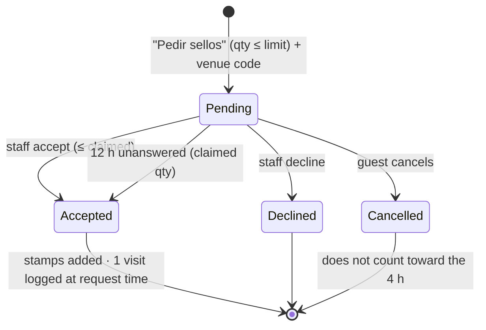

# Loyalty UX

Stamps-only loyalty. Guests prove presence with a rotating **venue code**, claim stamps with a **stamp request**, staff confirm the quantity (or silence accepts it after 12 h). Redemptions are validated by staff with one tap. No cameras, no QR scanning. Terms: _Loyalty_ in [CONTEXT.md](../../CONTEXT.md). Decision: [ADR 0007](../adr/0007-unanswered-stamp-requests-are-accepted.md). Implementation: [Loyalty](../domains/loyalty.md).

## Principles

- **Email is the only identity.** Unverified, no password. Same email on any device = same card.
- **Presence, not approval, gates earning.** The venue code is readable only at the counter and worthless minutes later. Staff approval only checks the quantity.
- **Staff silence never leaves a guest hanging.** Unanswered requests are accepted.
- **Pending stamps can't be spent.**
- **Redemption needs no presence check.** The payoff is physical, at the counter.
- **Near-zero onboarding.** The card token lives in `localStorage`.

Why a code: GPS spoofs and fails indoors, table-QR URLs get shared, Wi-Fi/IP checks break on mobile data. Reading four digits aloud costs about as much as stamping a paper card.

## Guest flow

1. **Join.** Floating card button on the public menu (`3/8` for a known guest, "Consigue premios" otherwise) → sheet with the reward pitch and one email field → card created, token saved.
2. **Ask.** "Pedir sellos" → "¿Cuántos?" stepper (1 … stamp request limit) → four-digit code. Pending stamps show as outlined slots ("3 pendientes") with **Cancelar**.
3. **Answer.** The card refreshes on open or focus (no polling, no email). Next open shows a one-time notice: filled stamps, "Confirmaron 2 de 3 sellos", or "Tu solicitud no fue aceptada".
4. **Redeem.** "Canjear" on an unlocked reward → pending redemption, card polls → staff tap **Validar** → success screen, stamps deducted. Pending redemptions expire after 10 min; stamps are only deducted on validation.

Limits: one request per card every 4 h (cancelled ones don't count; "Ya pediste sellos en esta visita"), 5 code attempts per minute per card.

## Staff (Fidelidad page, `loyalty.operate`)

Mobile-first, scoped to the device's active branch:

1. **Venue code**, large, with a countdown ring (rotates ~3 min).
2. **Solicitudes de sellos**: email, claimed quantity (stepper can only go down), request time ("hace 2 h · 18:42"), "Se acepta sola en 10 h". **Aceptar** / **Rechazar**. Collapsed "Últimas 24 h" list with **Deshacer**.
3. **Pending redemptions**: email, reward, cost, age. **Validar** / **Rechazar**.

- Every action toasts with **Deshacer** (a compensating `adjust`; refused if the stamps were already spent).
- Two devices answering the same row: the second gets a conflict and the list refreshes.
- No "accept all": doing nothing already accepts.
- Each stamp request is one [notification](notifications-ux.md) for its branch; push is per branch with a count.

Setup (Fidelización page): turn on, create rewards (`free_dish`, `percentage_discount`, `special_price`, each with a stamp cost), **Máximo de sellos por solicitud** (default 3, 1–10), optional **ticket medio** for the return chart.

## Insights

Pending stamps never count. Accepted stamps are dated at request time.

- Cards: active cards, stamps this month, redemptions this month, redemption rate, repeat-visit rate.
- Customer table (sortable, searchable, CSV) with an "inactive > N days" filter (default 30).
- Visits chart: new vs returning.
- **Retorno de fidelización** (estimate, labeled as correlation): revenue ≈ reward stamp cost (or real visit count) × ticket medio, against reward cost (`free_dish` = dish price, `special_price` = price − special, `percentage_discount` = % × ticket medio). Empty state without ticket medio.

## Security

- **Card token**: HMAC of `customer_id` + `restaurant_id`, long-lived (earning needs the code, redeeming needs staff).
- **Venue code**: `HMAC(LOYALTY_TOKEN_SECRET, restaurantId + branchId + floor(now / window))` → 4 digits, previous window accepted. Stateless.
- **Abuse ceiling**: someone at the table who hears the code can ask once per 4 h per email, and staff can lower or decline it.
- Every admin endpoint requires a `restaurant_users` session scoped to the restaurant.

## Not built

Wallet passes · points-per-euro · exact ROI from POS/orders · gift cards · staff PIN mode · configurable windows or fraud flags · campaigns to inactive customers · notifying guests when staff answer · staff granting stamps without a request.
