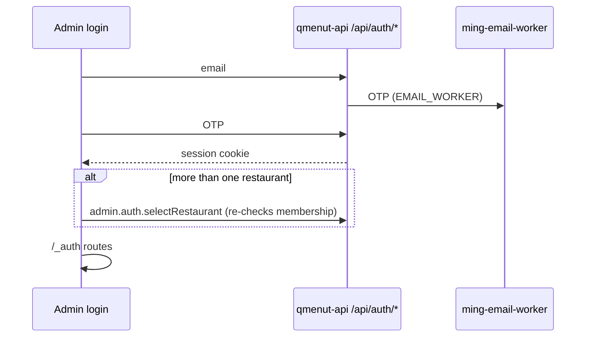

# Auth

Better Auth, passwordless email OTP, **sign-up disabled**: owners provision accounts in the Users panel. Auth says who you are; [Multi-tenancy](multi-tenancy.md) says which restaurant and role.

## Facts

- Server: `packages/auth/src/index.ts` (`emailOTP` plugin, Drizzle SQLite adapter, `usePlural`, base path `/api/auth`, `disableSignUp`). Built per request in `apps/api/src/auth/create-auth.ts`.
- Tuning (OTP length, expiry, attempts, session expiry): `packages/auth/src/store.ts`.
- Session has an extra field `activeRestaurantId`, written only by `admin.auth.selectRestaurant`.
- Client: `createEmailOtpAuthClient` (`credentials: include`), wrapped in `apps/admin/src/lib/auth-client.ts`.
- `protectedProcedure` reads the session via `ctx.getSession()`.
- Admin and API share the `qmenut.app` site for cookies (see [Deployment](../operations/deployment.md#domains)).

## Fixed OTP

`DEV_FIXED_OTP=true` lets every provisioned account sign in with `000000` and sends no email (local, E2E, dev Worker). `create-auth.ts` ignores it in production. **Never set it in production.**

## Accounts

- Owners create users + memberships from `apps/admin/src/features/users/`. The invitation email is informational; if it fails, the account stays and can be resent.
- Support accounts (`INTERNAL_SUPPORT_ACCOUNTS`) are protected `admin` members, hidden from the Users list.

## Key files

| Concern        | Path                                                                                      |
| -------------- | ----------------------------------------------------------------------------------------- |
| Server         | `packages/auth/src/index.ts`, `apps/api/src/auth/create-auth.ts`                          |
| Session schema | `packages/db/src/schema/auth.ts`                                                          |
| Switching      | `apps/api/src/trpc/routers/auth.ts`                                                       |
| UI and guard   | `apps/admin/src/features/auth/`, routes `login.tsx`, `select-restaurant.tsx`, `_auth.tsx` |
