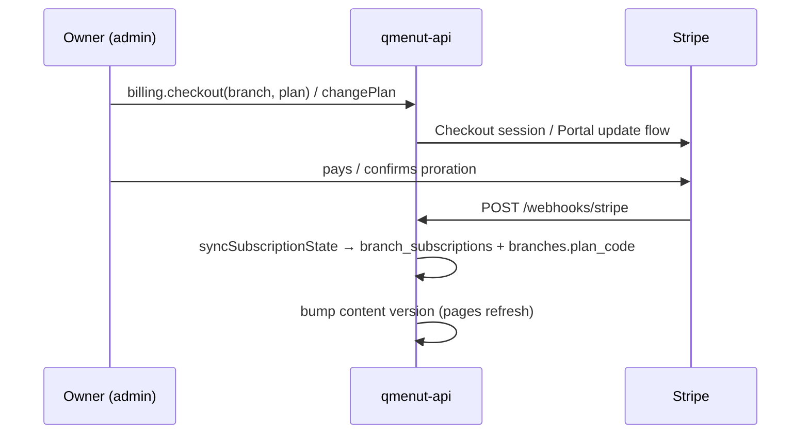

# Billing

Stripe, **one subscription per branch**, two plans: `basic` and `business`. 14-day trial with card up front. State converges only through webhooks. What each plan sells: [sales/plan-features.md](../sales/plan-features.md).

## Entitlements

- `branches.plan_code` is the effective plan; every check reads it. A canceled subscription falls back to `basic`.
- `PLAN_FEATURES` in `packages/permissions` lists Business-only keys; Basic has none.
- Branch features follow the branch's plan. **Restaurant features** (`languages`, `loyalty`, `analytics`, `users`) are on if **any** branch has them.
- API gates: `requireFeature` / `hasPlanFeature` (`apps/api/src/lib/billing/entitlement.ts`), `featureProcedure(feature)` for restaurant-wide routers.
- On Basic: non-owners lose admin access (support accounts exempt), DeepL is skipped, no analytics digest, the public payload drops Business content and `publicFeatures` hides pages.
- **Downgrades never delete data.** It comes back on upgrade.
- Admin: locked sections keep their nav entry with a "Business" label and render `PlanLockedState`; inline controls use `PlanLock`.

## Rules

- `checkout`: first-ever subscription gets the trial. `trialing` rows created by `qmenut-ops` (no Stripe ID) don't block it. Basic is refused for restaurants with more than one branch.
- `changePlan`: same rules, then Customer Portal `subscription_update_confirm`. The portal must allow switching between both products.
- Billing writes are owner-only (`billing.manage`).
- Never infer state from the Checkout response.

## Data

| Table                        | Holds                                                        |
| ---------------------------- | ------------------------------------------------------------ |
| `stripe_customers`           | Stripe customer per restaurant (`schema/billing.ts`)         |
| `branch_subscriptions`       | One per branch: `trialing`, `active`, `past_due`, `canceled` |
| `restaurant_stripe_accounts` | Stripe Connect account per restaurant                        |

## Key files

| Concern               | Path                                                                         |
| --------------------- | ---------------------------------------------------------------------------- |
| Router + handlers     | `apps/api/src/modules/billing/` (`sync-subscription-state.ts` is the funnel) |
| Stripe / plan catalog | `apps/api/src/lib/stripe/stripe-provider.ts`, `lib/billing/plan-catalog.ts`  |
| Repository            | `packages/db/src/repositories/billing.repository.ts`                         |
| Admin UI              | `apps/admin/src/app/routes/_auth.billing.tsx`                                |

## Limitations

- Prices live in `STRIPE_PRICE_BASIC` / `STRIPE_PRICE_BUSINESS` per Wrangler environment.
- The webhook maps one price per plan. Annual billing or a price change needs `planCodeFor` to map by product.
- Live mode needs live prices, secret key and webhook secret together.
