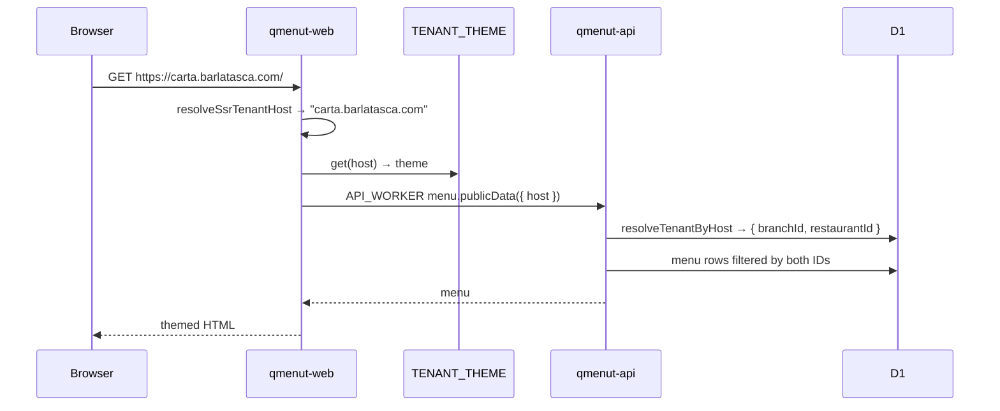

# Custom domains

A branch **is** its host. `branches.customDomain` holds it; resolution is an exact match. No subdomains, slugs or wildcards. The URL path only carries an optional `{-$locale}`.

## Rules

- Every host goes through `normalizeTenantHost` (lowercase, trim, strip protocol/port/path), on both read and write sides, so the KV key and the D1 lookup always agree.
- **Web** (`apps/web/src/server/tenant-host.ts`): `Host` is the only production source. `X-Forwarded-Host` is never trusted (tenant confusion, cache poisoning). In dev only, bare `localhost`/LAN IPs fall back to `VITE_PUBLIC_MENU_HOST` or `fine.localhost`.
- **API** (`apps/api/src/modules/tenant/resolve-tenant.ts`): an explicit `host` input wins, else the request host.
- **Reverse lookup** for admin writes: `resolveBranchHost` authorizes the branch and returns its domain; `PRECONDITION_FAILED` when it has none. `resolveBranchHostOrNull` is for cache invalidation.
- **No match → `null`.** There is no default tenant; new public entry points must handle it.

## TENANT_THEME KV

| Key                  | Value                                                           | Written by                 |
| -------------------- | --------------------------------------------------------------- | -------------------------- |
| `{host}`             | Full `QmTenantThemeConfig` ([Theming](theming.md))              | `putTheme`                 |
| `menuVersion:{host}` | `Date.now()`; public content version (all content, legacy name) | `bumpPublicContentVersion` |

- Only `apps/api/src/lib/theme/tenant-theme-store.ts` touches it (lint-enforced). Web reads it with a read-only type.
- api and web bind the **same** namespace ID per environment and the same local `preview_id`.

## Adding a domain

Cloudflare-side, not in code: attach the exact hostname to `qmenut-web` as a custom domain. See [Deployment](../operations/deployment.md#domains).

## Key files

| Concern            | Path                                                                                            |
| ------------------ | ----------------------------------------------------------------------------------------------- |
| Normalize / lookup | `packages/db/src/domain/tenant.ts`, `.../repositories/tenant.repository.ts`                     |
| API resolution     | `apps/api/src/modules/tenant/resolve-tenant.ts`, `modules/public-menu/resolve-public-tenant.ts` |
| Branch → host      | `apps/api/src/modules/admin-tenant/resolve-branch-host.ts`                                      |
| Web resolution     | `apps/web/src/server/tenant-host.ts`                                                            |
| KV store           | `apps/api/src/lib/theme/tenant-theme-store.ts`                                                  |
