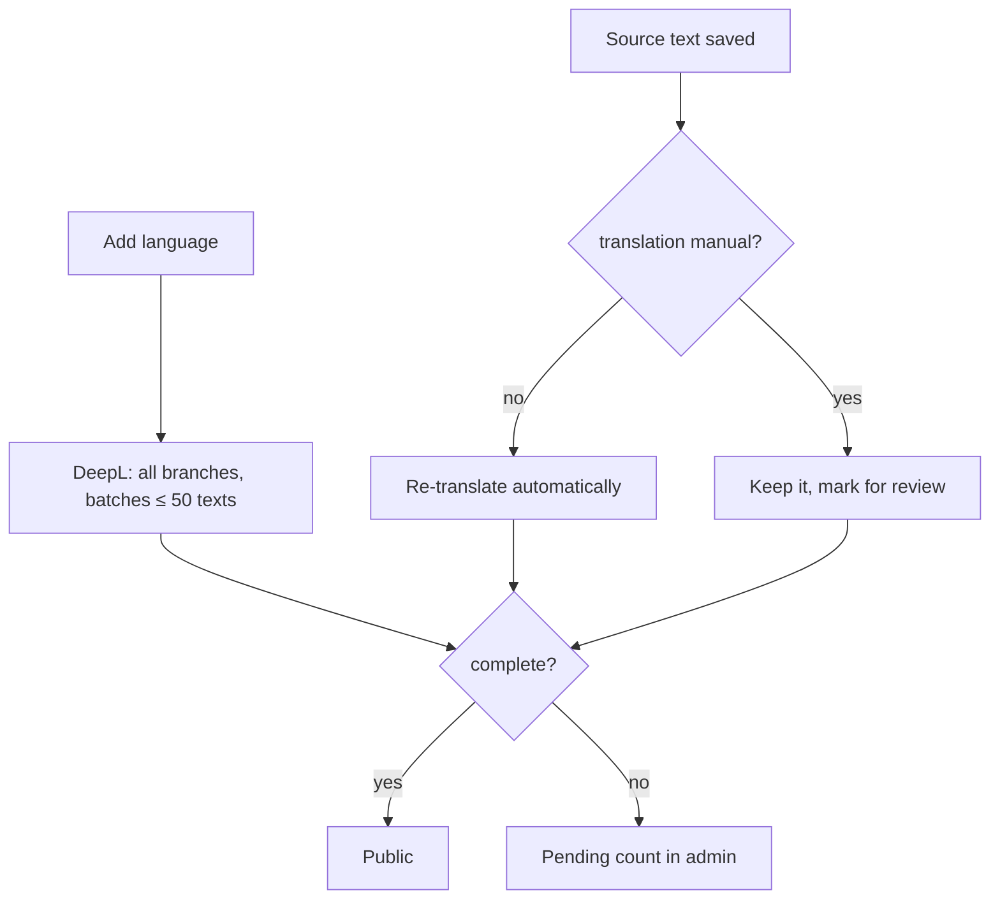

# Internationalization

Business feature `languages`, permission `languages.write`. Public UI strings are bundled (`apps/web/src/lib/i18n/resources`); menu translations are database content.

## Model (`packages/db/src/schema/translations.ts`)

| Table                  | Holds                                                                                                                  |
| ---------------------- | ---------------------------------------------------------------------------------------------------------------------- |
| `restaurant_languages` | Enabled languages. `restaurants.default_language_code` is the default: always on, never translated or removed.         |
| `translations`         | `(entityType, entityId, languageCode, field) → value`, plus `sourceText` (what it was translated from) and `isManual`. |
| `translation_locks`    | Fields kept in the default language in every language; DeepL never gets them.                                          |

Entity types: `dish`, `category`, `variant_group`, `variant_option`, `ingredient`, `promotion`, `branch` (tagline), `reward`. Shared ingredients and rewards affect every branch.

## Publication rule

A language is **public only when complete**: every nonempty source has a nonempty translation whose `sourceText` matches the current source. Incomplete languages show a pending count in admin, stay out of the public selector, and their URLs redirect to the default language. Pages never mix languages.



- **Completar traducciones** retries missing/stale machine translations, keeping good ones.
- **Retraducir contenido** overwrites everything, manual edits included, after confirmation. ([ADR 0002](../adr/0002-retranslate-instead-of-pending-translations.md))
- Removing a language deletes its availability and all its translations in one batch.

## DeepL

- Source language = restaurant default. Description HTML preserved, output sanitized before storage.
- Batches save as they finish; a failure can leave a partial (unpublished) language. The content version is bumped anyway.
- `DEEPL_API_KEY` needed for automatic translation (manual editing works without). `DEEPL_API_URL` picks the endpoint. Valencian starts from Catalan.
- Locale codes like `EN-GB` go in request metadata, never as text prefixes.
- Skipped on Basic.

## API and UI

- `admin.languages.*`: `catalog`, `list`, `add`, `remove`. `admin.translations.*`: `list`, `save`, `setLock`, `translateAll`. Both in `apps/api/src/modules/admin-translations/`.
- Editors validate ownership and reject stale source text. Pick a non-default content language in Languages or a content screen to edit translations; the default language edits the original.

## Check

```bash
bun test apps/api/scripts/check-translations.test.ts
```

Uses a fake in-memory provider. On macOS, set `SQLITE_LIBRARY_PATH` to a current SQLite if the system one can't rename tables with qualified `CHECK`s. Never write synthetic provider output into the local menu DB.
