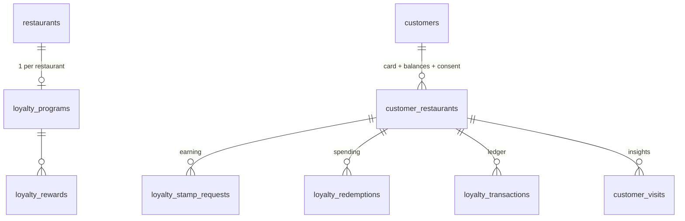
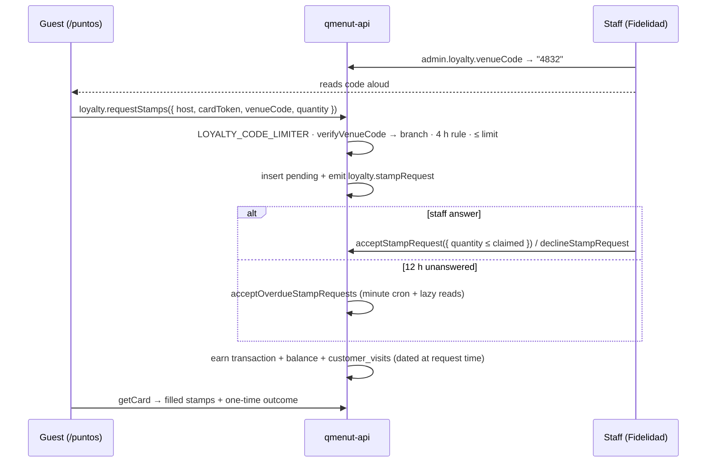

# Loyalty

One stamps program per restaurant (`points` mode exists in the schema but is dormant). Guests prove presence with a rotating venue code, claim stamps with a stamp request, staff confirm. Redemptions are validated by staff at the counter. Plan feature: `loyalty`. UX and reasoning: [Loyalty UX](../design/loyalty-ux.md), [ADR 0007](../adr/0007-unanswered-stamp-requests-are-accepted.md).

## Data model

| Table                    | Key facts                                                                                                                                                    |
| ------------------------ | ------------------------------------------------------------------------------------------------------------------------------------------------------------ |
| `loyalty_programs`       | PK `restaurantId`. `rulesJson` holds `ticketMedio` and `stampRequestLimit` (default 3, clamped 1–10). `stampsPerVisit` is unused.                            |
| `loyalty_rewards`        | `cost` + `type`: `percentage_discount` (`percentage`), `free_dish` (`freeDishId`), `special_price` (`specialPrice`).                                         |
| `loyalty_transactions`   | Ledger: `earn`, `redeem`, `adjust`, `expire`; signed amount.                                                                                                 |
| `loyalty_stamp_requests` | `pending → accepted / declined / cancelled`. `claimedQuantity`, `acceptedQuantity`, `autoAccepted`, `transactionId` + `visitId` (for undo), `outcomeSeenAt`. |
| `loyalty_redemptions`    | `pending → validated / rejected / expired`, `validatedBy`, `validatedAt`.                                                                                    |
| `customers`              | Unique `email`. No password.                                                                                                                                 |
| `customer_restaurants`   | PK `(customerId, restaurantId)`: balances, first/last visit, consent version (`loyalty-v1`) and date.                                                        |

Schema: `packages/db/src/schema/loyalty.ts`, `customers.ts`.

## Stamp request flow

| Rule                   | Where / how                                                                                                                                                     |
| ---------------------- | --------------------------------------------------------------------------------------------------------------------------------------------------------------- |
| One request per 4 h    | Race-safe `INSERT … SELECT … WHERE NOT EXISTS` in `createStampRequest`. Cancelled ones don't count. `CONFLICT` "Ya pediste sellos en esta visita".              |
| 5 code attempts / min  | `LOYALTY_CODE_LIMITER`, per card, successes included.                                                                                                           |
| Quantity ≤ limit       | `BAD_REQUEST` otherwise.                                                                                                                                        |
| Second staff answer    | `CONFLICT`.                                                                                                                                                     |
| Auto-accept after 12 h | Also after the program is turned off (the guest earned them while it was on).                                                                                   |
| Undo an acceptance     | Compensating `adjust`, visit deleted, request → `declined`. Refused if stamps were spent ("Los sellos ya se han canjeado"). Undo a decline → back to `pending`. |
| Notification           | `loyalty.stampRequest`, push mode `branchCount` (one replaceable push per branch with the count).                                                               |

## Venue code

`apps/api/src/lib/loyalty/venue-code.ts`. Stateless, TOTP-style:

- `getVenueCode`: HMAC(`restaurantId:branchId:windowIndex`) → 4 digits, 3-minute window.
- `verifyVenueCode`: accepts current + previous window, returns the matching branch.

## Card and consent

- Identity is an opaque signed card token in `localStorage`; every public call also carries `host`.
- `createCard` requires `consentAccepted: true` and stores the consent version + date. Re-registering keeps the balance; a newer policy version updates consent. Tokens without current consent go back to signup.
- `publicFeatures.loyalty` (program active + at least one active reward) shows or hides the tab. `/puntos` still renders an unavailable `noindex` state.

## API

| Router                                                         | Procedures                                                                                                                                                                                                                                                                                                               |
| -------------------------------------------------------------- | ------------------------------------------------------------------------------------------------------------------------------------------------------------------------------------------------------------------------------------------------------------------------------------------------------------------------ |
| `loyalty.*` (public)                                           | `program`, `createCard`, `getCard`, `requestStamps`, `cancelStampRequest`, `dismissStampOutcome`, `requestRedemption`, `cancelRedemption`, `redemptionStatus`                                                                                                                                                            |
| `admin.loyalty.*` (`featureProcedure("loyalty")` + permission) | `getProgram`, `saveProgram`, `createReward`, `updateReward`, `deleteReward`, `venueCode`, `pendingRedemptions`, `validateRedemption`, `rejectRedemption`, `undo`, `pendingStampRequests`, `acceptStampRequest`, `declineStampRequest`, `handledStampRequests`, `undoStampRequest`, `summary`, `customers`, `visitsChart` |

Repositories: `loyalty-ledger.repository.ts` (writes), `loyalty-admin.repository.ts`, `loyalty-insights.repository.ts`, `customers.repository.ts`.

## Key files

| Concern            | Path                                                                                                      |
| ------------------ | --------------------------------------------------------------------------------------------------------- |
| Public API         | `apps/api/src/modules/loyalty/`                                                                           |
| Admin API          | `apps/api/src/modules/admin-loyalty/` (`stamp-requests.ts`)                                               |
| Venue code / token | `apps/api/src/lib/loyalty/venue-code.ts`, `token.ts`                                                      |
| Public UI          | `apps/web/src/features/loyalty/`, route `{-$locale}.puntos.tsx`                                           |
| Admin UI           | `apps/admin/src/features/loyalty/`, routes `_auth.loyalty.*.tsx`                                          |
| Lit components     | `packages/ui`: `qm-loyalty-card`, `qm-loyalty-signup`, `qm-redeem-wait`, `qm-stamp-grid`, `qm-reward-row` |

## Limitations

- Email is unverified; anyone who knows it can see the card (earning still needs the code).
- `LOYALTY_TOKEN_SECRET` must be set and never reach a client bundle.
- Staff can't grant stamps without a request; guests aren't notified when staff answer.
