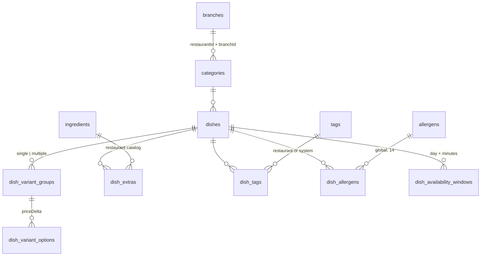

# Menu

Categories and dishes per branch, with variants, extras, tags, allergens and availability. Money is integer cents everywhere (`price`, `priceDelta`, extra prices).

## Model (`packages/db/src/schema/menu.ts`)

| Field                                | Meaning                                                               |
| ------------------------------------ | --------------------------------------------------------------------- |
| `categories.recurring*`              | Category schedule (Business `menu.schedules`).                        |
| `dishes.isFeatured`, `isRecommended` | Highlights (Business `highlights`).                                   |
| `isActive`                           | Availability toggle (`menu.toggleDishAvailability`, staff can do it). |
| `deletedAt`                          | Soft delete. E2E cleanup SQL removes test rows afterwards.            |

A "combo" is now just a price variant group (migration `0017` converted the old combo columns).

On Basic, writes keep the stored schedule and highlight flags but new rows are saved without them; nothing is deleted on downgrade.

## API

| Router                  | Procedures                                                                                     |
| ----------------------- | ---------------------------------------------------------------------------------------------- |
| `admin.menu.categories` | `list`, `create`, `update`, `reorder`, `remove`                                                |
| `admin.menu.dishes`     | `list`, `detail`, `create`, `update`, `saveRelations`, `remove`, `setAvailability`             |
| `admin.menu.taxonomy`   | `tags`, `allergens`, `ingredients`, `createIngredient`, `updateIngredient`, `removeIngredient` |
| `menu` (public)         | `publicData({ host })`, `googleReviews({ host })`                                              |

Admin procedures are `tenantProcedure` + `assertBranchAccess` + `requirePermission`. Image fields go through the image save operation ([Image uploads](../operations/image-uploads.md)). Descriptions are HTML, sanitized by `sanitize-description.ts`.

`publicData` returns the whole branch payload in one call: menu, effective prices ([Promotions](promotions.md)), translations ([i18n](i18n.md)), branch info and `publicFeatures` (which pages and features the web may show).

## Key files

| Concern          | Path                                                                                          |
| ---------------- | --------------------------------------------------------------------------------------------- |
| Admin API        | `apps/api/src/modules/admin-menu/`                                                            |
| Admin repos      | `packages/db/src/repositories/admin-{categories,dishes,menu-taxonomy}.repository.ts`          |
| Public read path | `apps/api/src/modules/public-menu/`, `packages/db/src/repositories/public-menu.repository.ts` |
| Admin UI         | `apps/admin/src/features/menu/`, routes `_auth.menu.*`                                        |
| Public UI        | `apps/web/src/features/menu/`                                                                 |
