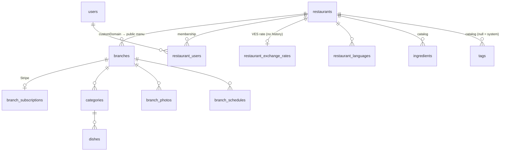
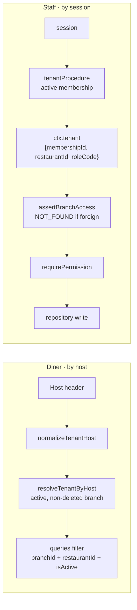

# Multi-tenancy

All tenants share one D1 database. Isolation is enforced in code, on two independent paths: **host** for diners, **membership** for staff.

## Model

| Table                       | Key facts                                                                                                                                                      |
| --------------------------- | -------------------------------------------------------------------------------------------------------------------------------------------------------------- |
| `restaurants`               | Tenant root. `countryCode` (ISO alpha-3) and `sourceCurrency` are fixed at creation. Also default language, `timezone`, legal fields, `deletedAt`.             |
| `branches`                  | Gets a public menu. `customDomain` is the routing key. `planCode`, `isActive`, `deletedAt`. Prices use the restaurant's currency. Unique `(id, restaurantId)`. |
| `restaurant_users`          | Membership: one account ↔ one restaurant, `roleCode`, active flag, last invitation state. Unique `(restaurantId, userId)`.                                     |
| `restaurant_exchange_rates` | At most one row per restaurant (USD-source only). Saving bumps every branch's content version.                                                                 |
| `categories`, `dishes`      | Carry **both** `restaurantId` and `branchId`. Menus are per branch, never shared.                                                                              |

Schema: `packages/db/src/schema/tenancy.ts` (re-exported by `restaurants.ts` and `branches.ts`), `menu.ts`, `exchange-rates.ts`.

## Roles

| Permission                                                           | owner | admin | staff |
| -------------------------------------------------------------------- | :---: | :---: | :---: |
| `menu.write`, `menu.toggleDishAvailability`                          |   ✓   |   ✓   |   ✓   |
| `loyalty.operate`, `exchangeRates.write`, `reservations.manage`      |   ✓   |   ✓   |   ✓   |
| `branch.write`, `promotions.write`, `theme.write`, `languages.write` |   ✓   |   ✓   |       |
| `loyalty.manage`, `loyalty.insights`, `analytics.read`               |   ✓   |   ✓   |       |
| `billing.manage`, `users.manage`                                     |   ✓   |       |       |

Source: `packages/permissions/src/index.ts`. Owners are protected from role change and deactivation. On Basic, non-owners lose access ([Billing](billing.md)). Support accounts (`INTERNAL_SUPPORT_ACCOUNTS`) are added as `admin` to every tenant the ops script creates, and are hidden and protected in the Users panel.

## Isolation

- **Public**: tenant comes only from the host. No client-supplied ID is trusted. Details: [Custom domains](custom-domains.md).
- **Admin**: clients never send a `restaurantId`. Membership resolves from `sessions.activeRestaurantId`, else the only active membership, else `FORBIDDEN`. It is re-checked every request, so revoking access is immediate.
- `admin.auth.selectRestaurant` is the one procedure that takes a restaurant ID, and it re-checks membership before writing it to the session. Multi-restaurant accounts get a selector after sign-in and a switcher in the sidebar.
- `assertBranchAccess` returns `NOT_FOUND`, not `FORBIDDEN`, so another tenant's branch can't be detected. Keep new branch-scoped mutations the same.
- Always write both `restaurantId` and `branchId` on menu rows (defense in depth).

## Key files

| Concern                    | Path                                                                                 |
| -------------------------- | ------------------------------------------------------------------------------------ |
| Host normalization         | `packages/db/src/domain/tenant.ts`                                                   |
| Host → tenant              | `packages/db/src/repositories/tenant.repository.ts`                                  |
| Public query isolation     | `packages/db/src/repositories/public-menu.repository.ts`                             |
| Session → tenant           | `apps/api/src/trpc/trpc.ts` (`tenantProcedure`), `restaurant-users.repository.ts`    |
| Restaurant switching       | `apps/api/src/trpc/routers/auth.ts`                                                  |
| Branch guard / permissions | `apps/api/src/modules/admin-tenant/assert-branch-access.ts`, `require-permission.ts` |
