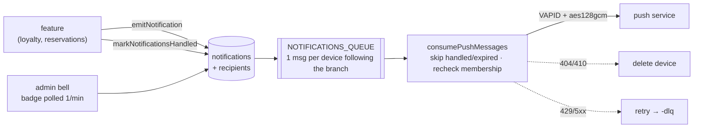

# Notifications

Staff inbox plus Web Push. Features emit events; this module decides who sees them and how. Available on every plan. UX: [Notifications UX](../design/notifications-ux.md). Decision: [ADR 0006](../adr/0006-notifications-through-cloudflare-queues.md).

## Events (`apps/api/src/modules/notifications/events.ts`, source of truth)

| Type                    | Actionable              | Push mode     |
| ----------------------- | ----------------------- | ------------- |
| `loyalty.redemption`    | until validated/expired | `each`        |
| `loyalty.stampRequest`  | until answered          | `branchCount` |
| `reservation.booked`    | no                      | `each`        |
| `reservation.cancelled` | no                      | `each`        |
| announcement            | no                      | `never`       |

- `each`: one push per event, dropped once handled. `never`: inbox only. `branchCount`: one replaceable push per branch with the unhandled count (same `tag` and `Topic`; topic hashed to RFC 8030's 32 chars), skipped at 0.
- `(type, subject_id)` is unique, so emitting twice is a no-op. `type` has no SQL check.
- Push links carry restaurant + branch; the admin checks access, selects the branch, then drops the params.

## Data model (`packages/db/src/schema/notifications.ts`)

| Table                     | Holds                                                                            |
| ------------------------- | -------------------------------------------------------------------------------- |
| `notifications`           | Event: type, branch (null = all), facts, shared handled state, expiry (30 days). |
| `notification_recipients` | One row per eligible member at emit time, with `read_at`.                        |
| `push_devices`            | Subscription per member, admin language, followed branches.                      |

**Recipients** = active members of a live restaurant who are owners or whose restaurant has the `users` feature, minus `INTERNAL_SUPPORT_EMAILS`. Same rule as admin access.

**Handling** outcomes: `validated`, `rejected`, `cancelled`, `cancelledByStaff`, `confirmed`, `expired`, `accepted`, `autoAccepted`, `declined`. `reopenNotification` clears it. Lazy expiry and auto-accept mark notifications too.

## Backend

- `emitNotification` never throws.
- Minute cron `runNotificationMaintenance`: delete expired notifications, expire stale redemptions, auto-accept 12 h stamp requests.
- `apps/api/src/lib/web-push.ts`: VAPID JWT + RFC 8291 encryption with WebCrypto only. Push is off unless all three `VAPID_*` secrets exist.
- `admin.notifications.*` (`tenantProcedure`): `list`, `badge`, `markRead`, `markAllRead`, `pushConfig`, `device`, `saveDevice`, `removeDevice`.

## Frontend

- `apps/admin/src/features/notifications/`: bell, page, push control, `services.ts` (renders text from type + facts in the admin language).
- `apps/admin/public/sw.js`: push and click handlers only, registered through the Trusted Types policy `qmenut-service-worker`.
- iPhone/iPad: push works only in the installed admin; the control explains how to install.

## Limitations

- Push control lives only on the notifications page.
- Announcements: `publishAnnouncement` exists, no UI calls it.
- No automated push test (encryption verified by a decrypt round trip).
