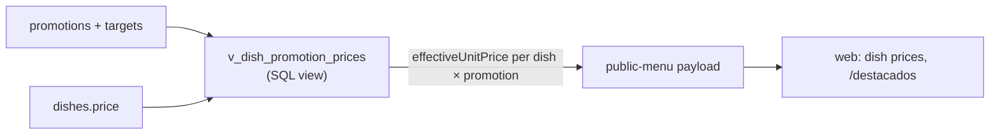

# Promotions

Business feature (`promotions`, plus `highlights` for the public `/destacados` page). Permission `promotions.write`.

## Model (`packages/db/src/schema/promotions.ts`)

| Column                                             | Values                                                                                                                                                  |
| -------------------------------------------------- | ------------------------------------------------------------------------------------------------------------------------------------------------------- |
| `type`                                             | `percentage_discount` (`percentage` 0–100), `special_price`, `daily_menu` (`specialPrice`), `happy_hour`, `two_for_one` (`buyQuantity`, `paidQuantity`) |
| `scope`                                            | `info` (announcement only), `branch`, `category`, `dish` (+ `promotion_targets`)                                                                        |
| `startsAt`, `endsAt`                               | Optional date range                                                                                                                                     |
| `isRecurring`, `recurringDays`, `recurring*Minute` | Weekly window                                                                                                                                           |
| `priority`                                         | Higher wins when several apply                                                                                                                          |
| `status`                                           | `active`, `inactive`, `expired`                                                                                                                         |

Checks in SQL enforce that each type has its required value.

**Effective prices come only from `v_dish_promotion_prices`.** Never recompute them in a client. The view is Drizzle-managed (`.as(...)`, not `.existing()`).

## API and UI

- `admin.promotions.*` (`tenantProcedure`): `list`, `get`, `create`, `update`, `remove`. Zod rules in `promotion-input.schema.ts`.
- Domain logic: `packages/db/src/domain/promotions.ts` (active windows), model `models/promotion.ts`, repos `{admin-promotions,promotions}.repository.ts`.
- Admin UI: `apps/admin/src/features/promotions/`, routes `_auth.promotions.*`.
- Public: route `{-$locale}.destacados.tsx` → `apps/web/src/features/promos/` (`HighlightsPage`: active promotions + recommended dishes, mapped from `publicData`). Edge TTL is 15 min because promotion windows are time-bound ([Caching](../operations/performance-and-caching.md)).
- Downgrade to Basic hides promotions publicly but keeps them in D1.
