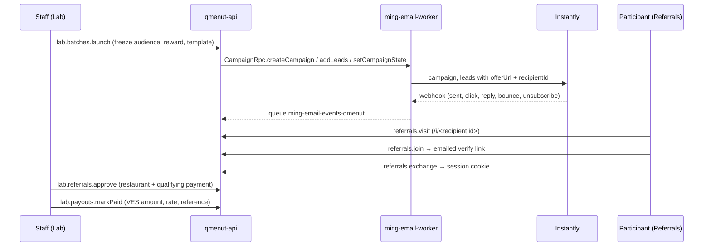
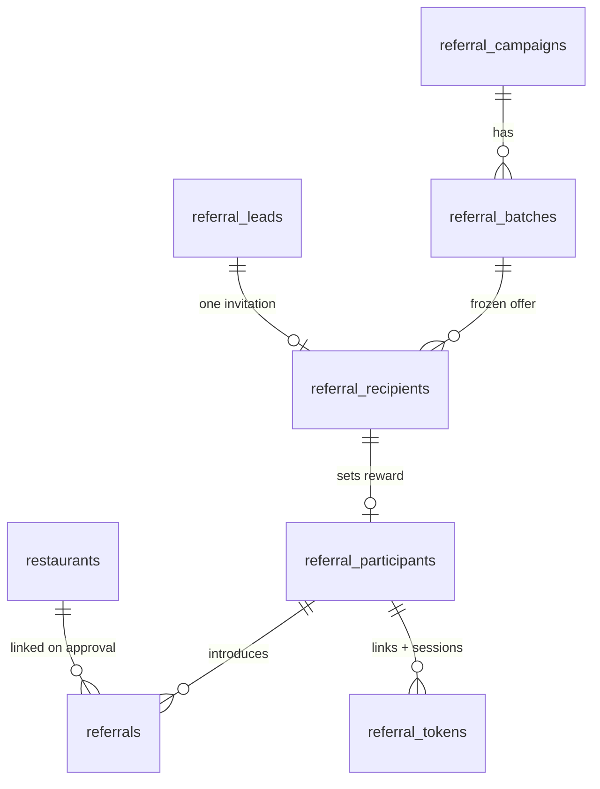

# Referral campaigns

QMenut emails batches of contacts an offer: a USD reward for every restaurant they introduce that buys QMenut Business annually. Staff run it from **Lab**; participants use the public **Referrals** app.

## Status

Version one: campaigns, referral review and manual payouts. Deferred: documents, automatic follow-ups, checkout changes, automated payouts.

## Flow



## Rules

| Rule                                                                                         | Where                                                                  |
| -------------------------------------------------------------------------------------------- | ---------------------------------------------------------------------- |
| Daily schedule: up to 150 contacts every day at 09:00 Caracas, $30 per qualifying restaurant | `campaign-schedule.ts` · `defaultBatch`                                |
| A batch takes the oldest active leads with no invitation and no participant account          | `ELIGIBLE_LEADS`, `lab-campaigns.ts`                                   |
| One invitation per person                                                                    | unique `referral_recipients.lead_id`; Instantly `skip_if_in_workspace` |
| Audience, reward and template version freeze at launch                                       | `referral_recipients.reward_cents`, `template_version`                 |
| An invitee keeps their invitation's reward for every referral, once their email is verified  | `upsertParticipant`, `public-referrals.ts`                             |
| Everyone else joins at $50                                                                   | `PUBLIC_REWARD_CENTS`                                                  |
| Qualifying purchase: Business paid annually, $468 minimum                                    | `approveInput`, `lab.router.ts`                                        |
| One approved reward per restaurant                                                           | partial unique index `ux_referrals_approved_restaurant`                |
| A reward is paid once                                                                        | `markPaid` updates only `payout_status = 'unpaid'`                     |
| States: received → in progress → approved, or rejected; payout unpaid → paid                 | `referrals.status`, `referrals.payout_status`                          |

## Data model

`packages/db/src/schema/referrals.ts`. Money is integer cents (VES too); the exchange rate is a decimal string.



`referral_email_events` logs Instantly events (id = hash of the webhook body, so retries deduplicate). `referral_audit` records every staff and participant action.

## Backend

- `lab.*` (`labProcedure`): Cloudflare Access JWT (signature, `aud`, `exp`) plus the `LAB_STAFF_EMAILS` allowlist. Restaurant memberships grant nothing. See [Lab access](../operations/deployment.md#lab-access-cloudflare-access).
- `referrals.*`: public offer, visit, join, access-link request and exchange; `participantProcedure` for `me`, `submit`, `savePayout`, `signOut`.
- Participant links: 32 random bytes in the URL fragment, SHA-256 stored, single use (`used_at` set atomically), verify 24 h, access 1 h. The page exchanges a link only on a tap, because email scanners open links. Sessions are an HttpOnly cookie on the referrals host for 30 days.
- Preparation (`campaign-jobs.ts`) runs at launch and on the minute cron: suppression, campaign creation, 500-lead uploads, activation. A lease prevents overlapping passes; progress is each recipient's status, so an interrupted pass resumes.
- Daily scheduling (`campaign-schedule.ts`): one button creates all daily batches for the latest imported list. Dates include weekends; the final group contains the remainder. The source label and template version are stored on the plan. Only the due group freezes its eligible audience. Concurrent starts reuse the same plan, and an atomic daily guard prevents multiple scheduled groups launching on the same Caracas day. After downtime, later dates move forward instead of releasing a backlog. Pause/resume affects groups that have not started; started groups retain their own controls.
- Scheduling uses the existing minute cron and needs the deployed API Worker for unattended execution. A local Vite/Wrangler session does not run Cloudflare cron automatically. `REFERRAL_DELIVERY=simulate` never sends campaign mail.
- Events (`email-events.ts`): first timestamp wins; bounces and unsubscribes suppress the lead for every later batch. Staff opt-outs also go to Instantly's block list. Invitation v2 offers "responde BAJA"; the email worker blocks explicit opt-out replies in Instantly and emits an unsubscribe event to Lab.
- `REFERRAL_DELIVERY=simulate` (local, dev): no Instantly calls, recipients count as sent at once, and access links are printed to the API log.

All email goes through `ming-email-worker`: `referral-access` on the transactional Cloudflare transport, campaigns through `CampaignRpc` and Instantly, test sends to the staff member's inbox. New batches use invitation v3, rendered with Ming light email styles and a plain-text alternative; older batches keep their frozen template version.

## Frontend

| App                                                  | Routes                                                                                                                                                   |
| ---------------------------------------------------- | -------------------------------------------------------------------------------------------------------------------------------------------------------- |
| `apps/lab` (`lab.qmenut.app`, port 5175)             | `/` overview · `/leads` import + list · `/campaigns`, `/campaigns/$id` · `/batches/$id` · `/referrals`, `/referrals/$id` · `/payouts` · `/announcements` |
| `apps/referrals` (`referidos.qmenut.app`, port 5176) | `/` public offer · `/i/$code` invitation · `/acceso` link exchange and request · `/mis-referidos` private page                                           |

Both are Vite SPAs whose Worker serves the assets and proxies `/trpc` to the API through a service binding (Vite's proxy locally), so no API origin or CORS is involved.

Lab `/campaigns` shows the daily schedule, the next seven dates and a searchable, paginated list of verified participants. Imported contacts and unverified form submissions do not appear in the participant list. Historical campaigns and manual batch controls remain available below. JSON imports accept the `email` field from the desktop contact export; the contact list stays in D1 and is never bundled into the frontend.

## Local run

```bash
bun run --cwd apps/api db:migrate:local
bun run --cwd apps/api dev
bun run --cwd apps/lab dev
bun run --cwd apps/referrals dev
```

Lab opens as `lab@qmenut.local`. Verify and access links appear in the API log as `[referrals] simulated email`.

## Limitations

- Duplicate warnings match normalized restaurant name or contact phone; staff decide.
- Lead import keeps one record per CSV line (no line breaks inside quoted cells).
- Restaurant search for linking is a substring match on the raw name.
- If an upload succeeds at Instantly but the recipient update fails, the retry marks those recipients failed ("already existing").
