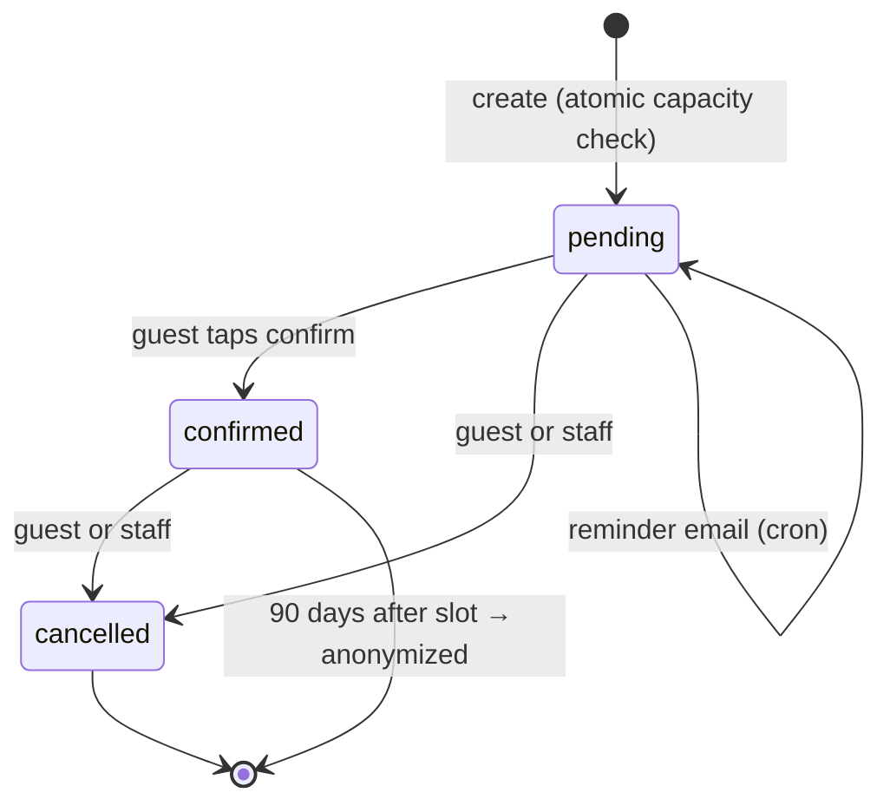

# Reservations

Instant booking on `/reservar`; the guest confirms or cancels from an email link; staff run a Day view. Plan feature `reservations` (Business), permission `reservations.manage` (owner, admin, staff), and `FEATURES.reservations` in `apps/admin/src/lib/features.ts`. UX: [Reservations UX](../design/reservations-ux.md). Decisions: [ADR 0004](../adr/0004-reservation-access-by-email-alone.md), [ADR 0008](../adr/0008-reservations-are-booked-and-confirmed-by-email.md). Terms: _Reservations_ in [CONTEXT.md](../../CONTEXT.md).

## Lifecycle

`pending` and `confirmed` both hold a table (`HOLDING_STATUSES`). One reservation counts once against slot capacity, whatever the party size.

## Data model (`packages/db/src/schema/reservations.ts`)

| Table                  | Holds                                                                                                                                                                 |
| ---------------------- | --------------------------------------------------------------------------------------------------------------------------------------------------------------------- |
| `reservation_settings` | One row per branch: on/off, slot capacity, party limit, window, lead time, reminder time (`check_before_minutes`).                                                    |
| `reservation_slots`    | Weekly start times (`weekday` 0 = Sunday, `start_minute` from local midnight).                                                                                        |
| `reservation_closures` | A closed date (`start_minute` null) or one closed slot.                                                                                                               |
| `reservations`         | Local `slot_date` + `slot_minute`, UTC `starts_at` (from `restaurants.timezone`), status, `cancelled_by`, `check_sent_at`, `anonymized_at`. Cascades with its branch. |

## Backend

- **Booking** is one `INSERT … SELECT` in `createReservation` (`reservations.repository.ts`) that checks the slot, closures and capacity, so two guests can't both get the last table. Returns `full` / `unavailable` when nothing was inserted.
- **Public** `reservations.*` (`modules/reservations/`, `publicProcedure`, tenant host): `availability`, `create`, `byEmail`, `emailFromLink`, `confirm`, `cancel`.
  - `availability` and `create` need the plan feature, the branch switch and at least one slot. Lookup/confirm/cancel keep working after a downgrade or switch-off.
  - Everything except `availability` is rate-limited by `RESERVATION_LIMITER` (10/min per branch + IP): they email or reveal reservations for any typed address.
- **Manage link**: `https://<branch domain>/<lang>/reservar?reserva=<id>`. `emailFromLink` only reveals the email; `confirm` / `cancel` need email + id, so confirming always takes a tap (email scanners open every link).
- **Admin** `admin.reservations.*` (`tenantProcedure` + `reservations.manage` + branch + plan check): `day`, `cancel`, `settings`, `saveSettings` (settings + weekly slots in one batch, bumps content version), `closures`, `addClosure`, `removeClosure`.
- **Cron** `runReservationJobs`: claim up to 50 due reminders and send them (skipping bookings made after the reminder time; a dropped email is not retried), then anonymize reservations 90 days past their slot.

## Messages

`announceReservations` (`reservation-messages.ts`) runs after each committed change and never throws.

| Event              | Guest email             | Staff notification      |
| ------------------ | ----------------------- | ----------------------- |
| Booked             | `reservation-booked`    | `reservation.booked`    |
| Reminder (cron)    | `reservation-reminder`  | —                       |
| Cancelled by guest | `reservation-cancelled` | `reservation.cancelled` |
| Cancelled by staff | `reservation-cancelled` | —                       |
| Confirmed          | —                       | —                       |

Email `data`: `restaurantName`, `branchName`, `branchPhone`, `date`, `time`, `partySize`, `guestName`, `locale`, `manageUrl` (null without a domain). Notifications carry no guest data and open `/reservations?date=<slot date>`.

## Key files

| Path                                                      | Responsibility                                    |
| --------------------------------------------------------- | ------------------------------------------------- |
| `packages/db/src/repositories/reservations.repository.ts` | Availability, booking, transitions, jobs          |
| `packages/db/src/domain/local-time.ts`                    | Restaurant-local dates and minutes                |
| `apps/api/src/modules/reservations/`                      | Public handlers, cron, messages                   |
| `apps/api/src/modules/admin-reservations/`                | Admin procedures                                  |
| `apps/web/src/features/reservations/`                     | `/reservar`; `qm-calendar` lives in `packages/ui` |
| `apps/admin/src/features/reservations/`                   | Day (`?date`, 1-min refresh), Settings, Closures  |

## Limitations

- Deploy `ming-email-worker` with the three templates before the API (English for English locales, Spanish otherwise). A rejected email goes to Sentry; the change stands.
- `EMAIL_WORKER` is remote even locally: a local booking emails a real address. No reservation E2E specs.
- Manage links are `https://` on the branch domain, so local bookings' links don't open locally.
- Capacity is one number per branch and slot. No table maps or meal durations.
