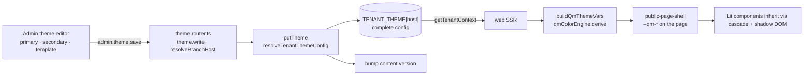

# Theming

A branch picks a **template** (`fine`, `her`, `fast`, `cafe`, `tapas`; default `her`) and two brand colors (plus optional tagline and fonts). The engine derives a legible palette and the full `--qm-*` CSS contract, rendered server-side so there is no flash.

## Engine (`packages/ui/src/theme/`)

| File                     | Does                                                                                                                       |
| ------------------------ | -------------------------------------------------------------------------------------------------------------------------- |
| `color-engine.ts`        | `qmColorEngine.derive()` → `bg`, `card`, `ink`, `muted`, `hairline`, `tint`, `emph`, `price`, `accent` and on-colors.      |
| `presets.ts`             | The 5 templates: fonts, scale, radius/border geometry, `photoMode`, `badgeShape`, `navStyle`, `saturationCap`, tone mixes. |
| `apply-theme.ts`         | `buildQmThemeVars(input)` (pure) builds every `--qm-*` token; `applyQmTheme` writes them.                                  |
| `tenant-theme-config.ts` | KV shape `QmTenantThemeConfig` and `resolveTenantThemeConfig` (invalid → default; partial → overlaid on its template).     |
| `font-catalog.ts`        | Allowed fonts and stacks.                                                                                                  |
| `tokens.ts`              | Typed CSS-variable contract.                                                                                               |

Primitives:

- `mix(a, pct, b)` emits `color-mix(in oklab, …)`. The **browser** mixes, so values cascade into shadow DOM.
- `clampChroma(hex, cap)` caps OKLCH chroma at the template's `saturationCap` so loud brand colors stay readable.
- `onColor(hex)` picks dark ink or white by OKLCH lightness.

> Colors are `color-mix()` / `oklch()` strings, never hex. Don't resolve them in code that expects hex.

## Rules

- KV always stores the **complete** config, so readers never need the template catalog.
- `getCachedTenantContext` reuses the theme across client navigations, never across SSR requests.
- A branch without `customDomain` has nowhere to store a theme (`PRECONDITION_FAILED`).
- The engine mirrors `derive()` from a reference `qmenut-theme.js`; keep them in step if that file is still authoritative.

## Dev template switcher

`?template=fine|her|fast|cafe|tapas` (dev only) overrides the tenant's template; `Cmd/Ctrl+1…5` cycles. Each template has a seed at `apps/api/seed/tenant-theme/*.localhost.json`, and `e2e/tests/web/templates.spec.ts` snapshots all five.

## Key files

| Concern          | Path                                                                                                      |
| ---------------- | --------------------------------------------------------------------------------------------------------- |
| Engine           | `packages/ui/src/theme/`                                                                                  |
| Web read / apply | `apps/web/src/server/tenant-theme.ts`, `app/routes/__root.tsx`, `shared/components/public-page-shell.tsx` |
| Admin editor     | `apps/admin/src/features/theme/`                                                                          |
| API              | `apps/api/src/modules/theme/theme.router.ts`, `apps/api/src/lib/theme/tenant-theme-store.ts`              |
