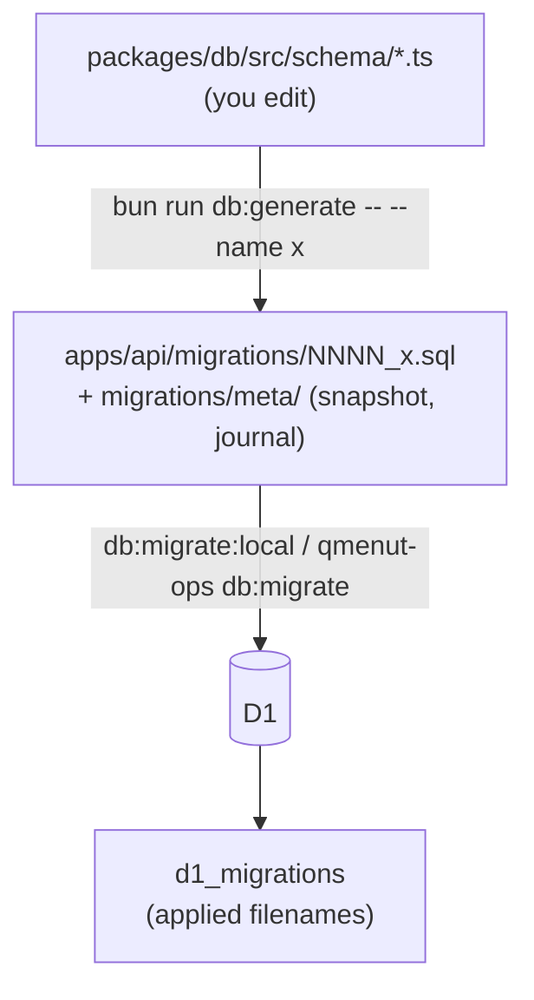

# Database migrations

The TypeScript schema is the source of truth. Drizzle Kit writes SQL; Wrangler applies it.



- Drizzle Kit never executes. There is no `__drizzle_migrations` table and no migrator in the Worker.
- Drizzle Kit reads **only** the barrel `packages/db/src/schema/index.ts`. A table not reachable from it gets no SQL. (`tenancy.ts` is reached via `restaurants.ts` and `branches.ts`.)
- `v_dish_promotion_prices` stays declared with `.as(...)`, never `.existing()`.
- History starts at `0000_squashed_baseline.sql` (tables, the view, and the allergen/system-tag catalog). It only applies to an empty database.

## Workflow

1. Edit `packages/db/src/schema/<domain>.ts`; make sure the barrel reaches it.
2. Generate:

   ```bash
   bun run db:generate -- --name <snake_case_change>
   ```

3. Read the SQL. Look for table rebuilds, dropped columns, lost indexes, FKs or defaults.
4. Validate and apply locally:

   ```bash
   bun run --cwd apps/api db:check
   ```

   ```bash
   bun run --cwd apps/api db:migrate:local
   ```

5. Commit schema + `.sql` + `migrations/meta/` together. Missing any one breaks `db:check` for everyone.
6. Remote: `bun run deploy --<env>` applies it, or run the wrapper alone (see [Production](#production)).

`bun run check` includes `db:check`, which fails when the schema differs from the latest snapshot.

### Data and custom migrations

Only for backfills, data transforms, catalog changes, or DDL Drizzle can't generate:

```bash
bun run --cwd apps/api db:generate:custom -- --name <change>
```

Never hand-write a migration file: the journal and snapshot must advance with it. Before committing, check: runs once safely? FK order? `NULL`s on a nullability change? What real rows look like? What's the compensating migration?

## SQLite rules

| Situation                      | Do                                                                                                                             |
| ------------------------------ | ------------------------------------------------------------------------------------------------------------------------------ |
| Allowed values                 | Add `check(...)`. A TS union is not enforced by SQLite.                                                                        |
| Relation                       | `.references()` or `foreignKey()` for composites.                                                                              |
| Tenant child row               | Composite FK `(branch_id, restaurant_id)`.                                                                                     |
| Soft delete index              | Partial index `WHERE deleted_at IS NULL`.                                                                                      |
| Boolean / money / time         | Integer (boolean mode) / minor units / epoch ms.                                                                               |
| Changing a column              | Expect a create-copy-drop-rename rebuild. Read it.                                                                             |
| Parent table referenced by FKs | **Never `DROP TABLE`**. Remote D1 cascades even with `foreign_keys=OFF`. Prefer additive `ALTER TABLE`. `db:check` rejects it. |
| Mistake already deployed       | New compensating migration. There are no down migrations.                                                                      |

Why the history was squashed: an old migration rebuilt `restaurants`/`branches` with `DROP TABLE`, D1 cascaded into every child table, and the database had to be restored. The leftover columns could not be dropped in place (Drizzle's self-qualified `CHECK`s block `DROP COLUMN`/`RENAME`), so the databases were rebuilt onto a fresh baseline with `bun run --cwd ../qmenut-ops db:rebuild -- <env>`.

## Applied migrations are immutable

Never edit, rename, reorder or delete one. D1 keys on the filename, so a rename replays it.

## Production

Databases: `qmenut-db` (prod), `qmenut-db-dev` (dev). IDs in `apps/api/wrangler.jsonc`.

```bash
bunx wrangler d1 migrations list DB --remote --env production --cwd apps/api
```

```bash
bun run --cwd ../qmenut-ops db:migrate -- production --confirm-production
```

The wrapper records a Time Travel bookmark, applies, and compares protected row counts. On failure or row loss it **stops and prints** the restore command; it does not restore by itself (a restore rewinds every write since the bookmark). Flags: `--allow-data-loss` for a reviewed deletion, `--auto-rollback` to restore unattended.

Checklist around every production migration:

1. `db:check` and re-read the SQL.
2. List pending migrations.
3. Query the affected tables. Never assume a table is empty.
4. Apply with the wrapper.
5. Verify schema and data directly, then `/health`, sign-in, and one DB-backed route.
6. Confirm no pending migrations remain.

## Never

`drizzle-kit push` · `wrangler d1 migrations create` · hand-written DDL files · editing production schema directly · touching `d1_migrations` · editing an applied migration or its snapshot.

## Commands

| Command                                                    | Does                                |
| ---------------------------------------------------------- | ----------------------------------- |
| `bun run db:generate -- --name <n>`                        | Generate DDL migration              |
| `bun run --cwd apps/api db:generate:custom -- --name <n>`  | Empty custom migration              |
| `bun run --cwd apps/api db:check`                          | Validate metadata vs schema         |
| `bun run --cwd apps/api db:migrate:local`                  | Apply to local D1                   |
| `bun run --cwd apps/api db:seed seed/seed-public-menu.sql` | Seed local D1                       |
| `bun run --cwd e2e reset`                                  | Wipe + migrate + seed local D1/KV   |
| `bun run --cwd ../qmenut-ops db:migrate -- <env> [...]`    | Safe remote apply                   |
| `bun run --cwd ../qmenut-ops db:rebuild -- <env>`          | Rebuild a remote DB onto a baseline |
