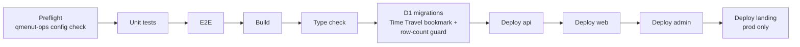

# Deployment

Product commands run from this repo; tenant and remote-DB commands run from the sibling `../qmenut-ops`.

> Run Wrangler as `bun run --cwd apps/<app> wrangler …`. It is installed only inside each app (pinned 4.151.3). From the repo root, `bunx wrangler` can't find it, downloads `wrangler@latest` instead, and crashes (`Cannot find module 'blake3-wasm'`); its `--cwd` flag applies too late to help.

## One command

```bash
bun run deploy --development
```

```bash
bun run deploy --production
```



- The environment flag is mandatory. The first failing step stops everything.
- Production migrations are auto-confirmed (`--production` is the acknowledgement). `--allow-data-loss` and `--auto-rollback` are forwarded to the migration wrapper.
- Build-time variables (`VITE_ADMIN_ORIGIN`, `VITE_API_BASE_URL`, `VITE_DEV_FIXED_OTP`) live in the map at the top of `scripts/deploy.ts`.

## Environments

| Worker  | Development (`--env development`)           | Production (`--env production`)        |
| ------- | ------------------------------------------- | -------------------------------------- |
| API     | `qmenut-api-dev` · `api.dev.qmenut.app`     | `qmenut-api` · `api.qmenut.app`        |
| Web     | `qmenut-web-dev` · `dev.qmenut.app`         | `qmenut-web` · each tenant domain      |
| Admin   | `qmenut-admin-dev` · `admin.dev.qmenut.app` | `qmenut-admin` · `admin.qmenut.app`    |
| Landing | —                                           | `qmenut-landing` · `qmenut.app`, `www` |
| D1      | `qmenut-db-dev`                             | `qmenut-db`                            |

- Top-level Wrangler config = local dev. Named environments **do not inherit** vars, D1, KV, services, queues, rate limits or observability, so each block repeats them and pins `name` (otherwise you get `qmenut-api-production` and broken bindings).
- Resource IDs live in `apps/*/wrangler.jsonc`. The `TENANT_THEME` `id` must be identical in api and web for each environment.
- Rate limiters need no provisioning: namespaces `1001–1004` (prod), `2001–2004` (dev).
- Development sets `DEV_FIXED_OTP=true` (OTP `000000`) and `ALLOW_INDEXING=false` (noindex everywhere).

## Prerequisites

- `qmenut.app` active as a Cloudflare zone; `bun run --cwd apps/api wrangler login` on the target account.
- In the **same account** (service bindings do not cross accounts):
  - `ming-email-worker`, with the reservation templates `reservation-booked`, `reservation-reminder`, `reservation-cancelled` (each takes `locale` and `manageUrl`). Deploy it before the API.
  - `ming-image-worker`, with the qmenut policy, buckets, notification, CORS and lifecycle (below).
  - `ming-exchange-rate-worker`.
  - `ming-msg-worker` only for the `/messaging` console (WhatsApp is on hold, [ADR 0003](../adr/0003-whatsapp-through-ming-msg-worker.md)).
- Stripe test + live accounts, Sentry projects (api, web, admin), a PostHog EU project, optional DeepL key.

## First-time provisioning

Replace `<sfx>` with nothing for production or `-dev` for development.

```bash
bun run --cwd apps/api wrangler d1 create qmenut-db<sfx>
bun run --cwd apps/api wrangler kv namespace create TENANT_THEME<sfx>
bun run --cwd apps/api wrangler queues create qmenut-notifications<sfx>
bun run --cwd apps/api wrangler queues create qmenut-notifications<sfx>-dlq
bun run --cwd apps/api wrangler queues create ming-msg-events-qmenut<sfx>
bun run --cwd apps/api wrangler queues create ming-msg-events-qmenut<sfx>-dlq
```

Copy the returned IDs into `apps/api/wrangler.jsonc` (D1, KV) and `apps/web/wrangler.jsonc` (KV). Leave the shared local `preview_id` unchanged.

Image storage, from `../ming-image-worker` (never put R2 credentials in qmenut):

```bash
bunx wrangler r2 bucket create qmenut-image-staging
bunx wrangler r2 bucket create qmenut-media
bunx wrangler r2 bucket notification create qmenut-image-staging --event-type object-create --queue ming-image-processing-production --prefix "products/qmenut/uploads/"
bunx wrangler r2 bucket cors set qmenut-image-staging --file examples/qmenut-staging-cors.json
bunx wrangler r2 bucket lifecycle add qmenut-image-staging qmenut-staging-fallback "products/qmenut/uploads/" --expire-days 1
```

Attach `qmenut-media` to `media.qmenut.app` as a public R2 domain. Keep staging private. Details: [Image uploads](image-uploads.md).

## Secrets (API only)

```bash
bun run --cwd apps/api wrangler secret put <NAME> --env <environment>
```

| Secret                                                   | Notes                                                                                               |
| -------------------------------------------------------- | --------------------------------------------------------------------------------------------------- |
| `BETTER_AUTH_SECRET`, `LOYALTY_TOKEN_SECRET`             | Long random values. Different per environment.                                                      |
| `STRIPE_SECRET_KEY`, `STRIPE_WEBHOOK_SECRET`             | Test mode in dev, live in prod.                                                                     |
| `VAPID_PUBLIC_KEY`, `VAPID_PRIVATE_KEY`, `VAPID_SUBJECT` | Staff push. Without them push is off, inbox still works. Rotating the pair kills every push device. |
| `POSTHOG_PROJECT_ID`, `POSTHOG_PERSONAL_API_KEY`         | Nightly analytics materialization.                                                                  |
| `GOOGLE_PLACES_API_KEY`                                  | Address autocomplete and Google reviews.                                                            |
| `DEEPL_API_KEY`                                          | Optional; translations degrade without it.                                                          |

Generate a VAPID pair:

```bash
bun -e 'const k=await crypto.subtle.generateKey({name:"ECDSA",namedCurve:"P-256"},true,["sign"]);const b=(u)=>Buffer.from(u).toString("base64url");console.log("VAPID_PUBLIC_KEY="+b(new Uint8Array(await crypto.subtle.exportKey("raw",k.publicKey))));console.log("VAPID_PRIVATE_KEY="+(await crypto.subtle.exportKey("jwk",k.privateKey)).d)'
```

`VAPID_SUBJECT` is a contact URL such as `mailto:soporte@qmenut.app`.

> Never set `DEV_FIXED_OTP` in production. `create-auth.ts` ignores it there and the preflight rejects it.

## Build-time variables

Compiled into bundles; changing one means rebuild + redeploy.

| App   | Variables                                                                                                                     |
| ----- | ----------------------------------------------------------------------------------------------------------------------------- |
| Web   | `VITE_SENTRY_DSN`, `VITE_POSTHOG_KEY`, `VITE_POSTHOG_HOST`. **Never** `VITE_API_BASE_URL` (browser uses same-origin `/trpc`). |
| Admin | `VITE_API_BASE_URL`, `VITE_SENTRY_DSN`, `VITE_DEV_FIXED_OTP` (dev only).                                                      |

Runtime `SENTRY_DSN` for api and web lives in each `wrangler.jsonc` environment.

### Web Worker quirk

`@cloudflare/vite-plugin` picks the environment **at build time** from `CLOUDFLARE_ENV` and writes a redirected config to `apps/web/dist/server/wrangler.json`. So:

```bash
CLOUDFLARE_ENV=production VITE_API_BASE_URL='' bun run --cwd apps/web build
```

```bash
bun run --cwd apps/web wrangler deploy
```

No `--env` on the deploy. The explicit empty `VITE_API_BASE_URL` overrides a local `apps/web/.env`.

## Domains

| Hostname                       | Target                                                         |
| ------------------------------ | -------------------------------------------------------------- |
| `api.qmenut.app`               | `qmenut-api` (declared; `workers_dev = false`)                 |
| `admin.qmenut.app`             | `qmenut-admin`                                                 |
| `qmenut.app`, `www.qmenut.app` | `qmenut-landing`                                               |
| `media.qmenut.app`             | R2 `qmenut-media` (not a Worker)                               |
| each `branches.customDomain`   | `qmenut-web` → Settings › Domains & Routes › Add custom domain |

- Admin and API must share the `qmenut.app` registrable domain (same-site cookies). Moving them apart needs `cookieMode: "cross-site"` in `apps/api/src/auth/create-auth.ts`.
- Tenant DNS must be on Cloudflare (or Cloudflare for SaaS). The attached hostname must equal `branches.customDomain` after normalization.

## New tenant

```bash
bun run --cwd ../qmenut-ops tenant:create -- --file tenants/CUSTOMER.tenant.json --remote --env production
```

Writes KV, then D1, verifies both, and prints the custom-domain step. Intake checklist: [Restaurant intake](onboarding-intake.md).

Development demo tenant (set a real inbox in `tenants/development.tenant.json` first):

```bash
bun run --cwd ../qmenut-ops tenant:create -- --file tenants/development.tenant.json --remote --env development
```

```bash
bun run --cwd ../qmenut-ops tenant:load-content -- --file demo-tenants/tapas.content.json --host dev.qmenut.app --remote --env development
```

Never clone production D1 into development (sessions, live Stripe refs, customer data). Recreate tenants from fixtures. Extra dev tenants get their own hostname (`cafe.dev.qmenut.app`) attached to `qmenut-web-dev`.

## Stripe

1. Create Basic and Business recurring prices → `STRIPE_PRICE_BASIC` / `STRIPE_PRICE_BUSINESS` in the API `vars`.
2. Webhook `https://api.qmenut.app/webhooks/stripe` with `checkout.session.completed`, `customer.subscription.updated`, `customer.subscription.deleted`, `invoice.payment_failed`.
3. Its signing secret → `STRIPE_WEBHOOK_SECRET`. Redeploy the API after changing price IDs.

`sync-subscription-state.ts` ignores unknown prices and subscriptions without `restaurantId`/`branchId` metadata.

## Crons

| Schedule     | Env       | Job                                                                       |
| ------------ | --------- | ------------------------------------------------------------------------- |
| `* * * * *`  | dev, prod | Image publication outbox, notification maintenance, reservation reminders |
| `45 4 * * *` | prod      | PostHog → D1 aggregates (last 3 days), 15-day owner digest email          |

The digest is at-least-once (no idempotency in the email worker) and has no unsubscribe yet.

Locally, crons don't fire; hit `/__scheduled?cron=*+*+*+*+*` on a Wrangler started with `--test-scheduled`.

## Smoke test

```bash
curl --fail -s https://api.qmenut.app/health
```

```bash
curl -s -D - -o /dev/null https://TENANT_DOMAIN/
```

1. `/health` → `{"status":"ok"}`.
2. Admin: OTP arrives, sign-in works, branch and theme load.
3. Upload a logo, a category image, a dish image and two gallery photos. Bytes go straight to a presigned R2 URL; saved URLs are `https://media.qmenut.app/.../main.webp`.
4. Request the tenant home twice: `X-QMenut-Cache: MISS` then `HIT`. Change the theme and repeat: `MISS` again.
5. `robots.txt` points at the same host's `sitemap.xml`.

## Rollback

```bash
bun run --cwd apps/api wrangler deployments list --name qmenut-api
```

```bash
bun run --cwd apps/api wrangler rollback --name qmenut-api
```

Same for `qmenut-web`, `qmenut-admin`, `qmenut-landing`. A Worker rollback does **not** revert D1: fix schema with a new compensating migration. `ming-image-worker` rolls back from its own repo; keep its qmenut policy backward-compatible.

## Workers Builds (CI deploy)

Workers Builds installs the whole workspace, and `@jmurga97/components` comes from GitHub Packages via the root `.npmrc`. Every connected Worker needs an encrypted build variable `NPM_TOKEN` (GitHub PAT, `read:packages` only), or install fails with `401`.

| Worker           | Root       | Build           | Deploy                                   |
| ---------------- | ---------- | --------------- | ---------------------------------------- |
| `qmenut-api-dev` | `apps/api` | `bun run build` | `bunx wrangler deploy --env development` |
| `qmenut-api`     | `apps/api` | `bun run build` | `bunx wrangler deploy --env production`  |

Use the pinned `bunx wrangler`, never `npx wrangler`. The orchestrator preflight does not run here.
