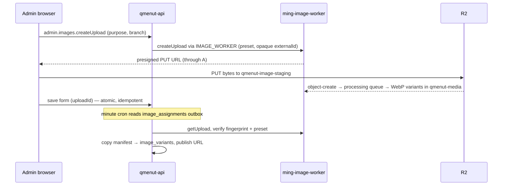

# Image uploads

Qmenut owns image ownership and publication. The private `ming-image-worker` owns
upload jobs, signed URLs, processing, attempts, failures, output variants and their
canonical manifests in its own D1 database.

Saves wait for the byte transfer; optimization and publication are asynchronous (≈1 minute via the cron outbox).

## Durable records and responsibilities

| Owner  | Record                               | Responsibility                                                                                                    |
| ------ | ------------------------------------ | ----------------------------------------------------------------------------------------------------------------- |
| Ming   | `image_upload_jobs` and its variants | Product-scoped processing lifecycle and manifest                                                                  |
| Qmenut | `image_uploads`                      | `uploadId`, restaurant, branch, purpose and creation time; no processing state                                    |
| Qmenut | `image_assignments`                  | Current publication intent for an entity/field, desired references, revision, publication result and next attempt |
| Qmenut | `admin_save_operations`              | Idempotent form saves committed with domain changes                                                               |
| Qmenut | `image_variants`                     | Public-menu read model copied from verified manifests                                                             |

`image_assignments` remains the table name to avoid a rename-only migration. Its
states are `pending`, `applied`, `failed`, `superseded`; they describe publication,
not Ming's `awaiting_upload`, `queued`, `processing`, `succeeded`, `failed` states.
Applied references retain both the `uploadId` and resolved URL. A newer intent
replaces the previous one; this is not an audit history.

## Save and publication sequence

1. The browser reserves uploads through `admin.images.createUpload`. The API checks
   tenant permissions and branch ownership, calls Ming with a closed preset and
   opaque `externalId`, and records ownership locally before returning the signed
   URL. Repeating creation with the same key recovers a failed local write.
2. The editor transfers files before saving, with at most three concurrent PUTs
   across the whole form (including branch logo and gallery together). The editor
   remains open until every PUT has received a successful HTTP acknowledgement.
   Ming may already be processing received files; the editor does not wait for it.
3. The form submits upload references. Qmenut verifies their ownership with one
   local query and commits domain data, publication intent and the save-operation
   record in the same D1 batch. This step does not depend on Ming being available.
   Only after a successful save does the editor release its navigation lock.
4. R2 notifications trigger Ming's existing processing queue. Ming writes optimized
   outputs and its manifest. After the PUT, publication does not depend on a browser.
5. Each minute Qmenut selects up to 20 due intents, ordered by deadline. It advances
   their retry deadline and reads Ming through the private service binding. One
   failing intent does not prevent the others from progressing. A crash or RPC
   outage leaves the record eligible for another cron.
6. When all images are ready, Qmenut verifies upload ID, product, ownership fingerprint,
   preset and expected WebP variants, then checks the current revision and live entity
   within the publication batch. It writes canonical URLs, gallery ordering, variant
   catalogue and `applied` together. Old images remain visible until the batch succeeds.
7. Public-cache invalidation runs after publication. `invalidated_at` is written only
   after success, so a failure is retried without republishing the images.

Removing/replacing an image supersedes the earlier intent. Deleted targets are not
repopulated. Keeping an image during an unrelated edit preserves pending work.
Gallery changes publish as one set; a partial failure preserves the whole old set.
The public menu reads its local variant catalogue and never calls Ming at render time.

## Browser feedback and retries

Files, previews and transfer state belong to the open editor. There is no global
file coordinator, browser upload queue or transfer retry from the activity panel.
Saving validates the form and all selected files before any reservation. Save and
Cancel are replaced by a shared progress component, and editing, navigation,
branch/restaurant switching and logout are blocked during the operation. A native
beforeunload warning covers reload/close; the browser can still be forcibly closed.

The form displays “Preparando subida…”, then “Subiendo archivos… N %”. The single
percentage is weighted by transferred bytes across all selected files, not the
average of file percentages. XMLHttpRequest upload events supply actual progress.
At 100% it displays “Confirmando recepción…” until all HTTP responses succeed,
then “Guardando datos…”. Optimization has no invented percentage. Forms without
new files retain their normal save feedback. The reusable file transport and form
progress component can also serve future large-file uploads.

On a transfer failure, the editor stops starting new transfers and waits for active
ones to settle before restoring controls. Save retries the operation. Confirmed
files retain their upload ID and are not PUT again if the form save fails. Upload
reservation retries retain the same idempotency key; queued, processing and completed
Ming jobs skip PUT even when the original response was lost. Replacing a file starts
a new selection and key. Control requests have a 20-second timeout; PUT has a
five-minute timeout. Unmounting aborts outstanding editor transfers.

After saving, the persistent panel shows “Datos guardados. Estamos preparando las
imágenes.”, followed by “Imágenes actualizadas.” after publication. It reads only
durable assignments, recovers after reload, refreshes the editor queries on publication
and retains server processing/publication retries. If an older assignment lacks its
source or Ming cannot retry it, the owner must select another file in the editor.
A worker outage preserves pending publication. A stable processing/manifest error
requires attention; an unfinished job after 24 hours since the last publication
request or retry is also surfaced. This deadline does not cancel the Ming job.

Files are not persisted in browser storage. Closing before the save confirmation
can lose the draft, but closing after it cannot interrupt transfers: they are already
received. Optimized but unreferenced output cleanup and backfilling old external
images are not implemented.

## Worker contract and authorization

The API uses the existing generic `createUpload`, `getUpload`, and `retryUpload`
RPC envelopes through the `IMAGE_WORKER` binding and `ImageRpc` entrypoint.
Ming receives `productId: "qmenut"`, a preset, and an opaque ownership reference;
it never interprets restaurant IDs, dish IDs, gallery ordering or Qmenut permissions.
It enforces product-scoped job reads and retries. The caller is a trusted backend;
browsers cannot call this private service or choose arbitrary storage/transforms.

Qmenut additionally hashes restaurant, branch and purpose into `externalId` and
verifies that fingerprint and the preset when reading the result. Local ownership
records authorize new pending form references. Existing pending assignments from
migration 0003 can still complete through their existing fingerprint verification;
new reservations are recorded in `image_uploads`.

The legacy completed-URL save inputs remain supported and are revalidated against
Ming. Existing external URLs are accepted only when unchanged from the domain record.
Signed URLs, credentials, source bytes, filenames and ownership fingerprints must
not be logged or persisted in Qmenut.

| Purpose         | Preset                | Expected outputs                                                    |
| --------------- | --------------------- | ------------------------------------------------------------------- |
| Branch logo     | `qmenut-logo`         | `main` (512px maximum WebP), `favicon` (48×48 ICO wrapped from PNG) |
| Gallery         | `qmenut-branch-photo` | `main` (1600px maximum), `w160`, `w430`, `w860`                     |
| Category / dish | `qmenut-menu-image`   | `main` (1024px maximum), `w160`, `w430`, `w860`                     |

The logo `favicon` variant is served per branch through `/favicon.ico` on the public
menu, which redirects to it via the branch's `faviconUrl` (the `image/x-icon`
`image_variants` row) and falls back to the committed default icon. Logos uploaded
before the variant existed are filled in by the variant backfill with `presetId:
"qmenut-logo"`.

JPEG, PNG and WebP inputs are limited to 25 MiB. Presets scale down; equal effective
widths are deduplicated in Qmenut's catalogue. Outputs use `media.qmenut.app` and
immutable cache headers. Ming deletes successful staged originals; abandoned staging
objects have a one-day lifecycle fallback. Replaced optimized outputs are not deleted.

## Storage and deployment

The staging bucket is `qmenut-image-staging`; output is `qmenut-media`. Its
`object-create` notification targets Ming's processing queue for the prefix
`products/qmenut/uploads/`. Staging CORS allows PUT with Content-Type from:

- `https://admin.qmenut.app`
- `https://admin.dev.qmenut.app`
- `http://localhost:5174`

The policy must match `ming-image-worker/examples/qmenut-staging-cors.json`.
Local and E2E configurations use the remote shared image binding, so regular upload
E2E tests are not isolated. Use a fake binding for failure checks.

Publication runs on the API minute cron (`* * * * *`); there is no qmenut image queue.
For local Wrangler, trigger the scheduled handler with `--test-scheduled` and
`/__scheduled?cron=*+*+*+*+*`; local cron events do not run automatically.

Verify the deployed Ming presets before the real development smoke. Then check all
four purposes and three file types, PUT completion followed by closing the tab,
public URLs, actual dimensions/MIME/cache headers, catalogue, responsive delivery
and invalidation. Local validation alone does not establish that R2 notifications,
CORS or the currently deployed shared worker are configured correctly.
