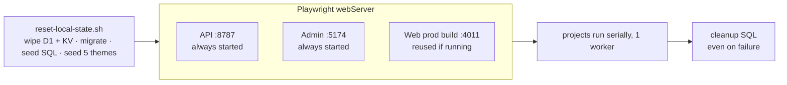

# Testing

No CI. Unit tests: `bun run test` (`packages/ui`). Browser tests: Playwright in `e2e/`, against the real multi-Worker stack. Don't add tests unless asked (`AGENTS.md`).

Coverage matrix and test-writing rules (Spanish): [e2e/README.md](../../e2e/README.md).

## Setup (once)

```bash
bunx playwright install chromium
```

```bash
echo "127.0.0.1 tapas.localhost fine.localhost cafe.localhost her.localhost fast.localhost" | sudo tee -a /etc/hosts
```

The hosts entry is mandatory: one web build serves every tenant and tests only change `Host`.

## Run

```bash
bun run dev:kill
```

```bash
bun run test:e2e
```



Stop `bun run dev` first: API and admin ports must be free. Web persists into `apps/api/.wrangler/state`, so it sees the same KV.

## Projects

| Project            | Device          | Scope                                        |
| ------------------ | --------------- | -------------------------------------------- |
| `setup`            | Desktop Chrome  | OTP sign-in → `.auth/admin.json`             |
| `admin`            | Desktop Chrome  | `tests/admin`                                |
| `web`              | Pixel 7         | `tests/web` (mobile)                         |
| `web-desktop`      | Desktop Chrome  | `desktop-*.spec.ts`                          |
| `cross`            | Desktop Chrome  | `tests/cross` (admin → public journeys)      |
| `critical-webkit`  | iPhone 13       | `@critical` only                             |
| `critical-firefox` | Desktop Firefox | `@critical` only                             |
| `visual`           | Pixel 7         | Template snapshots; only with `E2E_VISUAL=1` |

## Identities

Every provisioned account uses OTP `000000` while `DEV_FIXED_OTP=true` (local, E2E, dev Worker; never production).

| Email                   | Role        |
| ----------------------- | ----------- |
| `e2e@test.local`        | Tapas owner |
| `admin.e2e@test.local`  | Tapas admin |
| `staff.e2e@test.local`  | Tapas staff |
| `owner.fine@test.local` | Fine owner  |

## Visual snapshots

Baselines are per OS (`snapshots/{test}/{platform}/`). Supported baseline: macOS, generated locally. For Linux, run the whole `visual` project in a pinned container; never rename macOS images.

```bash
E2E_VISUAL=1 bun run test:e2e -- --project=visual
```

## Not covered

Real email delivery, remote image processing and payments. `EMAIL_WORKER` and `IMAGE_WORKER` are `remote: true` even locally: bookings email real guests and uploads hit the shared buckets, so don't add upload E2E until there is a local fake.
